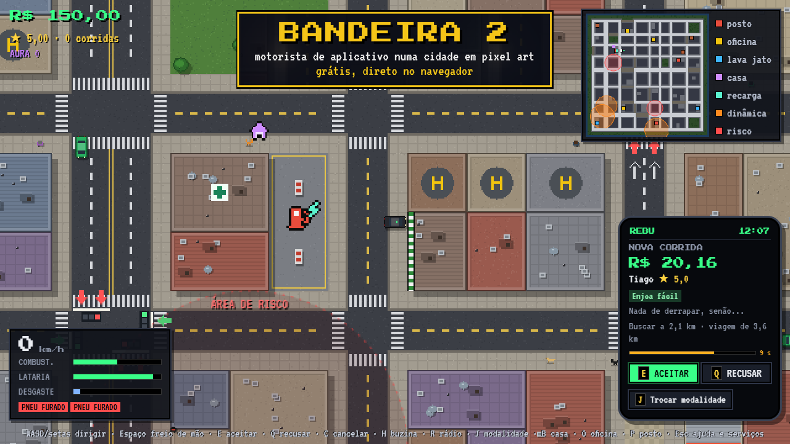
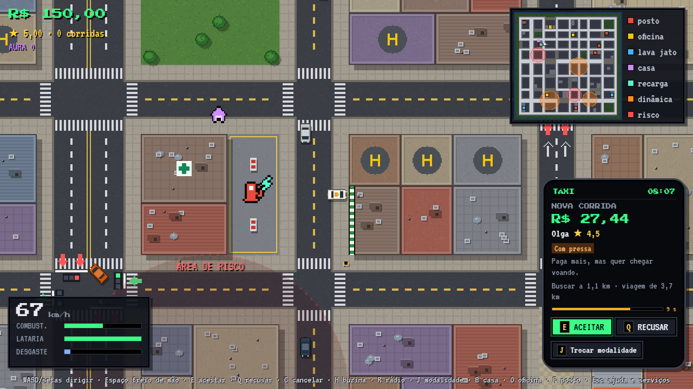
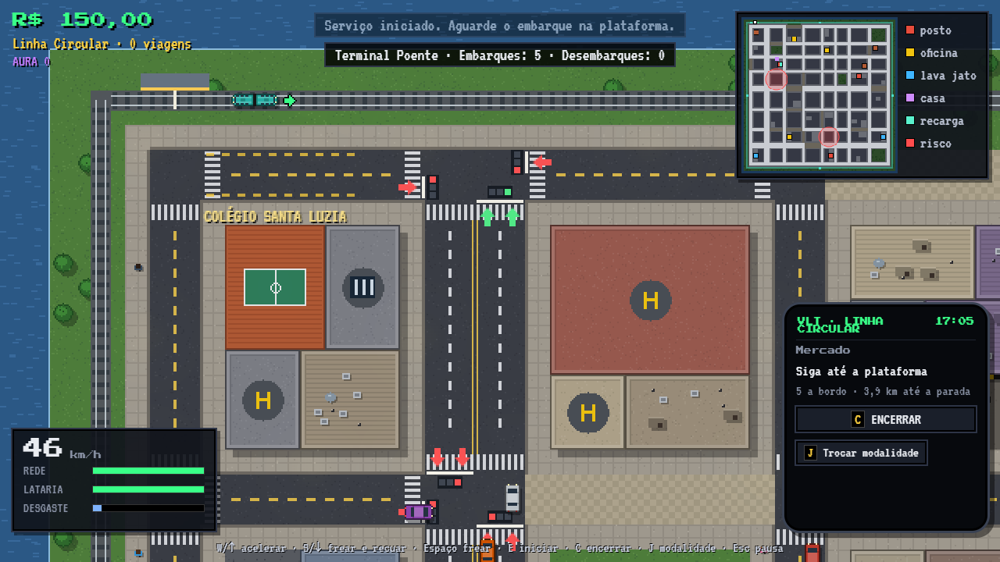
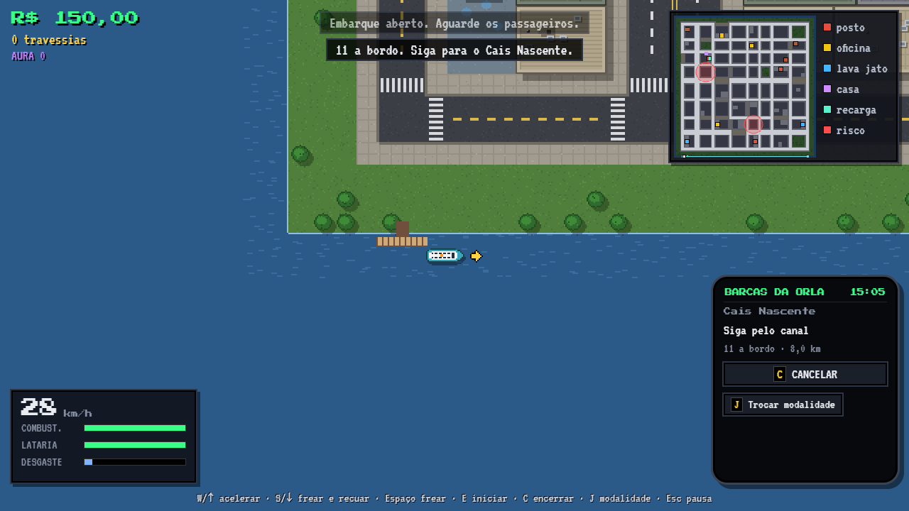
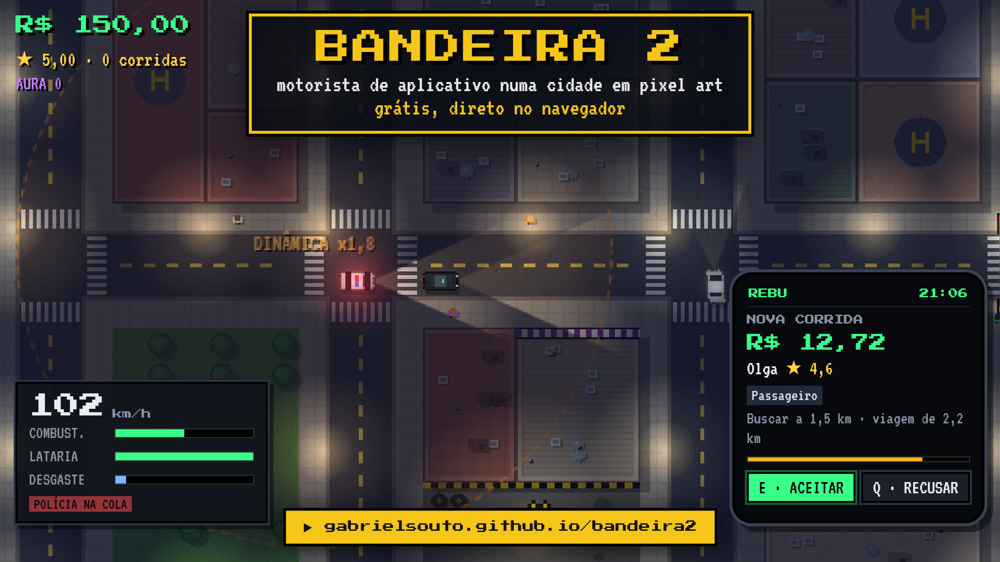

# Bandeira 3

Versão em Three.js com câmera fixa de cima. Abra `index.html` ou execute `npm start` para jogar. As imagens de referência abaixo são do Bandeira 2 original.

[](https://gabrielsouto.github.io/bandeira3/)

**[▶ Jogar no navegador](https://gabrielsouto.github.io/bandeira3/)** · [Controles e regras](https://gabrielsouto.github.io/bandeira3/ajuda.html) · [Jogar com amigos](#jogar-com-amigos) · [Rodar localmente](#rodar-localmente)

Às oito da noite, o táxi começa a cobrar bandeira 2. Até lá, dá tempo de levar a turma à escola, entregar um açaí antes que derreta ou assumir a cabine do VLT. Neste arcade de direção com câmera de cima, você escolhe como ganhar a vida na cidade. Ruas, veículos e pedestres são desenhados por código. Enquanto dirige, você pode ouvir rádio ao vivo.

| Táxi · uma chamada com pressa | VLT · próxima parada, Mercado | Barcas · rumo ao Cais Nascente |
| :---: | :---: | :---: |
| [](docs/imagens/taxi.png) | [](docs/imagens/vlt.png) | [](docs/imagens/barca.png) |

## Sua primeira corrida

1. Na tela inicial, mantenha o **Rebu** e aperte **Enter** para começar. Se quiser ajuda para frear e alinhar o carro com a rua, ative **Direção fácil**.
2. Quando o celular tocar, aperte **E** para aceitar. Dirija com **WASD** ou as **setas**, siga a **seta verde** e pare ao lado do passageiro. Espere ele entrar.
3. Siga a **seta amarela** até o destino e pare para receber. Chegar no prazo e evitar batidas ajuda a ganhar uma nota melhor e uma gorjeta.

O solo salva seu progresso automaticamente no navegador. Para experimentar outro serviço durante o jogo, termine ou cancele o trabalho atual, estacione e aperte **J**. Ao voltar ao jogo, você começa com a opção escolhida em **Seu veículo → Trocar**. Para retomar um passeio com cachorros, por exemplo, escolha o Passeador.

## Modalidades do solo

O solo tem **22 opções**, incluindo um trabalho a pé e uma gincana de carro pelas ruas da cidade.

| Trabalho | Veículos e serviços | O que acontece no turno |
| --- | --- | --- |
| Corridas | Rebu, 66, Táxi, Moto Rebu e Carro elétrico | Busque passageiros e aproveite a tarifa dinâmica. O táxi cobra bandeira 2 das 20h às 6h. No elétrico, localize o posto com carregador. |
| Comida e farmácia | euComida, 66Comida e Farmácia de bike | Retire o pedido na loja e leve até a porta do cliente. A comida esfria e, na bicicleta, quem precisa recuperar o fôlego é você. |
| Fretes e encomendas | Rebu Envios, Mercado Leve, Amazoom e Xopi | No Rebu Envios, leve um pacote de pessoa para pessoa, às vezes com PIN. Nas rotas de galpão, escolha a ordem das paradas e cuide dos pacotes frágeis. |
| Transporte de passageiros | Van escolar, Ônibus urbano, VLT, Barcas e Táxi aéreo | Busque os alunos em casa, pare nos pontos da Linha 01, percorra cinco estações sobre trilhos, contorne a ilha de barca ou pouse nos helipontos da cidade. |
| Emergências | Ambulância e Polícia | Leve o paciente ao hospital ou assuma a viatura para atender ocorrências e fazer rondas. |
| Autoescola | Carro de aula | Siga as instruções de voz, respeite as placas de PARE e estacione na vaga. A sexta aula é a prova do DETRAN. |
| Passeios a pé | [Passeador de cachorros](https://gabrielsouto.github.io/bandeira3/ajuda.html#passeador) | Busque até três cachorros, passe por cinco paradas em três quarteirões e receba de cada tutor ao devolver o cachorro. |
| Desafios de rádio | [Gincana da Rádio](https://gabrielsouto.github.io/bandeira3/ajuda.html#gincana) | Resolva duas pistas e cumpra o desafio final. Uma missão vale R$ 80, com mais R$ 40 se você resolver as duas pistas sem pedir dica. |

Entre um serviço e outro, o trânsito para no sinal, crianças atravessam na porta da escola e os postes acendem ao anoitecer. Se furar um pneu, pare e aperte **T** para montar o estepe. Você também pode fazer a troca na vaga de casa, onde dá para lavar o veículo e instalar um kit GNV no carro ou na van.

[](https://gabrielsouto.github.io/bandeira3/)

## Jogar com amigos

Abra **Jogar com amigos**, escolha um apelido e clique em **Criar sala**. Compartilhe o link ou o código de quatro caracteres. Cabem **até quatro jogadores**, ao volante de Rebu, 66, Táxi ou Moto Rebu. Quem criou a sala aperta **Enter** para iniciar o turno.

Todos largam com **R$ 150** às 7h e têm **12 minutos reais** até as 19h. As chamadas aparecem para todos. **Q** destaca a próxima e **E** indica o caminho, mas leva a corrida quem parar primeiro ao lado do passageiro. Quer disputar na pista? **X** chama um pega. Durante o turno, a inscrição custa R$ 20 por piloto e o vencedor leva o pote.

Quem já embarcou um passageiro às 19h tem mais 30 segundos para entregá-lo. Vence quem fizer mais lucro, com desempate pela nota média. O dinheiro da sala fica separado do progresso solo.

## Rádio do carro

Aperte **R** para ligar o rádio e avançar uma estação por vez. Depois das quatro estações do jogo, você ouve oito emissoras ao vivo nesta ordem. São elas **FM O Dia**, **Super Rádio Tupi**, **Rádio Cidade**, **JB FM**, **Antena 1**, **Rádio Globo do Rio**, **BandNews FM Rio** e **CBN Rio**. Mais um toque em **R** desliga só o rádio. **M** silencia ou reativa todo o som do jogo. [Guia do rádio](https://gabrielsouto.github.io/bandeira3/ajuda.html#radio)

## Controles rápidos

| Teclas | Ação |
| --- | --- |
| **WASD** ou **setas** · **Espaço** | Dirigir ou caminhar com os cachorros · freio de mão ao dirigir |
| **E** · **Q** · **C** | Aceitar, recusar ou cancelar um serviço no solo |
| **J** · **B** | Trocar de modalidade ao estacionar · traçar rota para casa no solo |
| **O** · **P** · **L** | Mostrar o caminho até oficina, posto ou lava jato |
| **H** · **R** · **M** | Buzinar, mudar a estação do rádio ou ligar e desligar o som |
| **F** · **Esc** | Alternar a direção fácil · abrir a pausa |

Os comandos específicos de cada veículo ficam no [manual do jogador](https://gabrielsouto.github.io/bandeira3/ajuda.html).

## Rodar localmente

O cliente inclui a versão compilada do Three.js. Abra `index.html` diretamente ou execute `npm start` e acesse [localhost:4173](http://127.0.0.1:4173/). Depois de editar o código em `src/`, execute `npm ci` e `npm run build`.

<details>
<summary><strong>Multiplayer local, testes e publicação</strong></summary>

As salas usam WebSocket e Cloudflare Durable Objects. Para jogar em rede localmente, mantenha o servidor de arquivos aberto e inicie o servidor das salas em outro terminal, com Node.js e npm instalados.

```sh
cd server
npm ci
npm run dev
```

Abra [a sala TEST](http://localhost:4173/?sala=TEST) em duas janelas lado a lado para manter os dois jogos visíveis. O cliente em localhost procura o servidor em `ws://localhost:8787`.

| Parâmetro de URL | Uso |
| --- | --- |
| `sala=TEST&turno=2` | Disputar um turno de dois minutos no servidor local |
| `lag=200&jitter=60` | Simular latência e variação na entrega das mensagens |
| `servidor=ws://host:porta` | Conectar o cliente a outro servidor |
| `hora=21` | Começar o solo à noite |

**Testes.** Na raiz, rode `node --test test/input.test.cjs test/solo.test.cjs`. Em `server/`, use `npm test` para as regras da sala ou `npm run fumaca` para um turno ponta a ponta com o servidor local em execução. Para simular outro jogador na sala TEST, rode `node test/robo.mjs TEST` ou `node test/pega-bot.mjs TEST`.

**Publicação.** O GitHub Pages serve a raiz da branch `main`. Ao editar o renderizador em `src/`, execute `npm run build` e inclua `game.bundle.js` no commit. As salas usam o serviço multiplayer do Bandeira 2. Ao alterar o protocolo, mantenha `PROTO` e `NET_PROTO` sincronizados. O endereço de produção é configurado por `NET_SERVER_PROD`. [Servidor da sala](server/src/sala.js) · [Cliente WebSocket](js/net.js)

</details>

<details>
<summary><strong>Onde encontrar o código</strong></summary>

| Parte do jogo | Arquivos |
| --- | --- |
| Tela, menus e progresso | [Página inicial](index.html) · [Loop e save](js/main.js) · [Painel, celular e minimapa](js/hud.js) |
| Cidade e direção | [Geração do mapa](js/city.js) · [Arte em pixel](js/render-city.js) · [Física](js/car.js) · [Veículos](js/vehicles.js) |
| Trabalhos | [Corridas](js/rides.js) · [Entregas](js/delivery.js) · [Encomendas](js/parcels.js) · [Demais módulos](js/) |
| Salas e testes | [Regras do servidor](server/src/regras.js) · [Testes da sala](server/test/) · [Testes do cliente](test/) |

</details>
